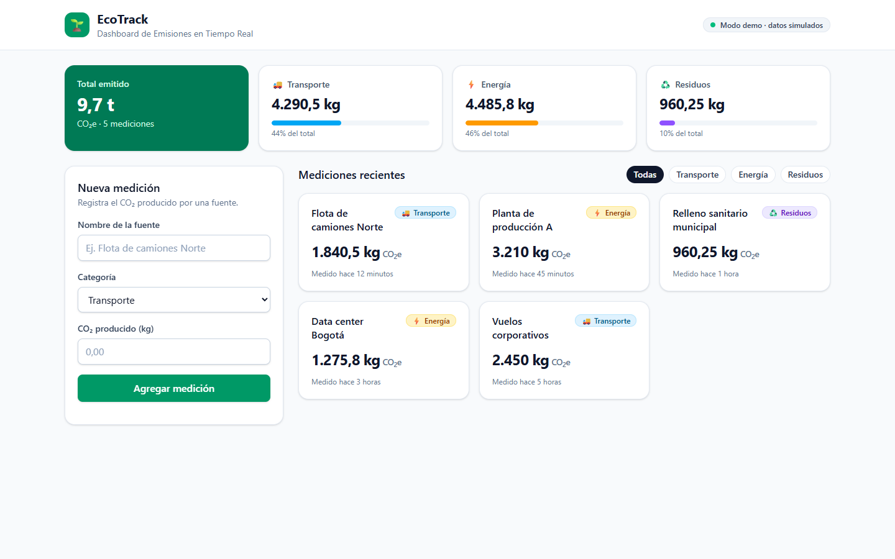

# EcoTrack · Dashboard de Emisiones en Tiempo Real

Componente `EmissionsTracker` y hook `useEmissions` construidos con React 19 + TypeScript (Vite),
Supabase y Tailwind CSS v4.



## Ejecutar

```bash
npm install
npm run dev
```

Sin archivo `.env`, la app arranca en **modo demo** con datos simulados. Un "sensor"
simulado agrega una medición cada 20 s para mostrar las actualizaciones en tiempo real.

- `?demo=slow` → carga lenta (muestra los skeletons)
- `?demo=error` → fallo de carga (muestra el mensaje de error y el botón "Reintentar")

### Conectar Supabase real

1. Ejecuta `supabase/migrations/001_create_emissions.sql` en el SQL Editor de tu proyecto.
2. Copia `.env.example` a `.env` y completa `VITE_SUPABASE_URL` y `VITE_SUPABASE_ANON_KEY`.
3. `npm run dev`: el indicador cambia a "En vivo · Supabase Realtime".

## Estructura

```
src/
├── types/emission.ts                 Tipos del dominio (Emission, NewEmission, categorías)
├── lib/supabase.ts                   Cliente único de Supabase (null si no hay .env)
├── services/emissions.service.ts     Interfaz EmissionsService + implementación Supabase y mock
├── hooks/useEmissions.ts             Carga, inserción, errores, Realtime y totales (useMemo)
└── components/EmissionsTracker/
    ├── EmissionsTracker.tsx          Contenedor: layout, filtros y estados de carga/error/vacío
    ├── EmissionCard.tsx              Tarjeta (React.memo)
    ├── EmissionForm.tsx              Formulario accesible con validación
    ├── EmissionsSummary.tsx          Totales por categoría
    └── format.ts                     Formato de números/fechas y estilos por categoría
supabase/migrations/                  SQL de la tabla, RLS y Realtime
docs/BITACORA_PROMPTS.md              Bitácora del ciclo Spec-to-Code
docs/capturas/                        Capturas y video de demostración
```

## Scripts

| Comando | Descripción |
|---|---|
| `npm run dev` | Servidor de desarrollo |
| `npm run build` | Chequeo de tipos estricto + build de producción |
| `npm run lint` | oxlint |
